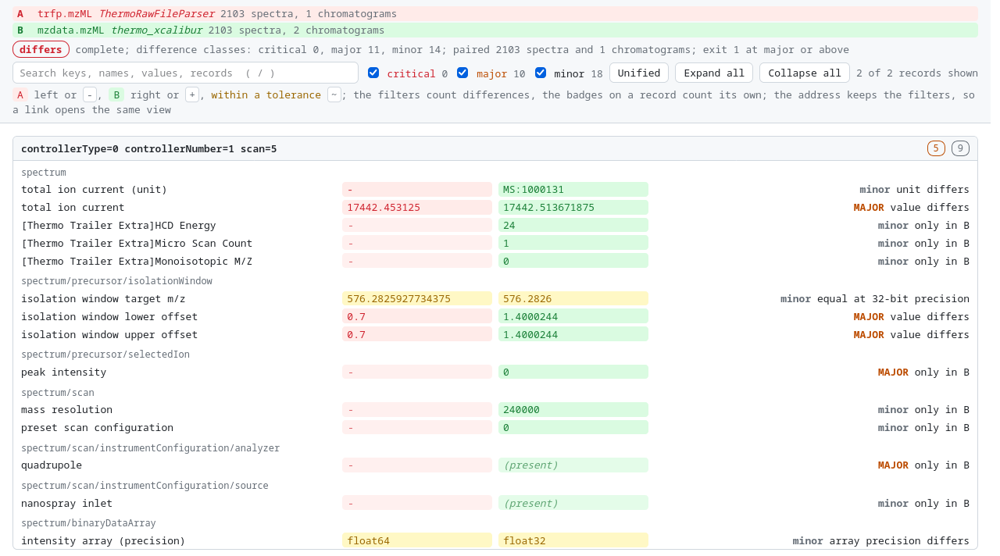

<!-- markdownlint-disable MD033 MD041 -->

<p align="center">
  
</p>

<p align="center">
  Compares two mzML files by what they mean, not by their bytes. Native, streaming, in Zig.
</p>

<p align="center">
  <a href="https://github.com/eneskemalergin/mzDiff/actions/workflows/ci.yml"></a>
  <a href="https://ziglang.org/download/"></a>
  <a href="#status-and-limits"></a>
  <a href="#license"></a>
</p>

<p align="center">
  <a href="#quick-start">Quick start</a> | <a href="#what-it-looks-like">Output</a> | <a href="#install">Install</a> | <a href="#documentation">Documentation</a> | <a href="#speed">Speed</a> | <a href="#status-and-limits">Status</a>
</p>

<!-- markdownlint-enable MD041 -->

---

mzdiff compares a reference mzML (A) with an output under test (B) and reports every difference that changes what a reader would get, classed as critical, major, or minor. I built it to check [mzBridge](https://github.com/eneskemalergin/mzBridge), my native Thermo `.raw` converter, against the ThermoRawFileParser mzML of the same run. It checks other converters the same way.

Two converters never write the same bytes: ids, offsets, number spelling, parameter order, and software names all differ. mzdiff ignores that bookkeeping by rule and compares what is left: every spectrum and chromatogram, paired in any order; every attribute, cvParam, and userParam; the decoded arrays; and the header. A difference it fails to report is its worst defect, so every check has a case in a defect harness that shows it can fail, and the severities were checked against what a search engine does with each defect ([Consumer check](https://github.com/eneskemalergin/mzDiff/wiki/Consumer-check)).

It also reports where B writes the same data in a form readers fail on (a charge written `2.0`, parameters moved into a group, Numpress arrays), since a file that matches the reference value for value can still break a search engine. What a file must be on its own (index offsets, checksum, schema, vocabulary) is left to [mzValidate](https://github.com/eneskemalergin/mzValidate).

## Quick start

```bash
mzdiff REFERENCE.mzML OTHER.mzML                  # report: difference classes, most severe first
mzdiff --summary REFERENCE.mzML OTHER.mzML        # one line: the verdict and its counts
mzdiff --list REFERENCE.mzML OTHER.mzML           # every difference, in the order found
mzdiff --view REFERENCE.mzML OTHER.mzML           # the differing records as a git-style diff
mzdiff --view --html A.mzML B.mzML > diff.html    # the same, as an interactive page to open
mzdiff -q A.mzML B.mzML && echo "nothing that matters differs"
```

## What it looks like

A PRM run from PRIDE [PXD006618](https://www.ebi.ac.uk/pride/archive/projects/PXD006618), converted by ThermoRawFileParser (A) and by the [mzdata](https://github.com/mobiusklein/mzdata) converter (B):

```text
$ mzdiff --severity major --examples 1 trfp.mzML mzdata.mzML
A  trfp.mzML  (ThermoRawFileParser)
B  mzdata.mzML  (thermo_xcalibur)
spectra        A 2103  B 2103  paired 2103
chromatograms  A 1  B 2  paired 1
result         differs: 0 critical, 11 major, 14 minor difference classes

MAJOR
      2103  value differs              spectrum/precursor/isolationWindow  MS:1000828 (isolation window lower offset)
            controllerType=0 controllerNumber=1 scan=1  A: 0.7  B: 1.4000244
      2103  value differs              spectrum/precursor/isolationWindow  MS:1000829 (isolation window upper offset)
            controllerType=0 controllerNumber=1 scan=1  A: 0.7  B: 1.4000244
      2103  only in B                  spectrum/precursor/selectedIon  MS:1000042 (peak intensity)
            controllerType=0 controllerNumber=1 scan=1  A: -  B: 0
      2103  only in B                  spectrum/scan/instrumentConfiguration/analyzer  MS:1000081 (quadrupole)
            controllerType=0 controllerNumber=1 scan=1
      2014  value differs              spectrum  MS:1000285 (total ion current)
            controllerType=0 controllerNumber=1 scan=1  A: 15869.6875  B: 15869.7529296875
         1  record only in B           chromatogram  @id (chromatogram)
            TIC  A: -  B: TIC
         1  missing in B               mzML/fileDescription/fileContent  MS:1000810 (ion current chromatogram)
            header
         1  only in B                  mzML/instrumentConfiguration/analyzer  MS:1000081 (quadrupole)
            header
         1  only in B                  mzML/instrumentConfiguration/analyzer  MS:1000083 (radial ejection linear ion trap)
            header
         1  only in B                  mzML/instrumentConfiguration/detector  MS:1000253 (electron multiplier)
            header
         1  missing in B               run  @startTimeStamp
            header  A: 2015-10-14T03:22:49.63Z  B: -

11 of 25 classes shown (--severity, --key)
```

<details>
<summary>The summary, as text, TSV, and JSON</summary>

```text
$ mzdiff --summary trfp.mzML mzdata.mzML
complete: differs | classes: critical 0, major 11, minor 14 | spectra: A 2103, B 2103, paired 2103 | chromatograms: A 1, B 2, paired 1

$ mzdiff --summary --tsv trfp.mzML mzdata.mzML
completion	status	fail_on	critical	major	minor	a_spectra	b_spectra	paired_spectra	a_chromatograms	b_chromatograms	paired_chromatograms
complete	differs	major	0	11	14	2103	2103	2103	1	2	1

$ mzdiff --summary --json trfp.mzML mzdata.mzML
{
  "schema_version": 1,
  "tool": {"name": "mzdiff", "version": "0.1.0"},
  "a": {"path": "trfp.mzML", "software": "ThermoRawFileParser", "spectra": 2103, "chromatograms": 1},
  "b": {"path": "mzdata.mzML", "software": "thermo_xcalibur", "spectra": 2103, "chromatograms": 2},
  "paired": {"spectra": 2103, "chromatograms": 1},
  "completion": "complete",
  "status": "differs",
  "fail_on": "major",
  "totals": {"critical": 0, "major": 11, "minor": 14}
}
```

</details>

<details>
<summary>The list</summary>

```text
$ mzdiff --list --severity major --limit 8 trfp.mzML mzdata.mzML
header
  MAJOR    missing in B               mzML/fileDescription/fileContent  MS:1000810 (ion current chromatogram)
  MAJOR    only in B                  mzML/instrumentConfiguration/analyzer  MS:1000081 (quadrupole)
  MAJOR    only in B                  mzML/instrumentConfiguration/analyzer  MS:1000083 (radial ejection linear ion trap)
  MAJOR    only in B                  mzML/instrumentConfiguration/detector  MS:1000253 (electron multiplier)
  MAJOR    missing in B               run  @startTimeStamp  A: 2015-10-14T03:22:49.63Z  B: -
controllerType=0 controllerNumber=1 scan=1
  MAJOR    value differs              spectrum  MS:1000285 (total ion current)  A: 15869.6875  B: 15869.7529296875
  MAJOR    value differs              spectrum/precursor/isolationWindow  MS:1000828 (isolation window lower offset)  A: 0.7  B: 1.4000244
  MAJOR    value differs              spectrum/precursor/isolationWindow  MS:1000829 (isolation window upper offset)  A: 0.7  B: 1.4000244

10424 more differences not shown (--limit)
complete: differs | classes: critical 0, major 11, minor 14 | spectra: A 2103, B 2103, paired 2103 | chromatograms: A 1, B 2, paired 1
```

</details>

<details>
<summary>The view, unified and side by side</summary>

```text
$ mzdiff --view --severity major --record "controllerType=0 controllerNumber=1 scan=5" trfp.mzML mzdata.mzML
controllerType=0 controllerNumber=1 scan=5
  spectrum
  - total ion current = 17442.453125                              MAJOR value differs
  + total ion current = 17442.513671875
  spectrum/precursor/isolationWindow
  - isolation window lower offset = 0.7                           MAJOR value differs
  + isolation window lower offset = 1.4000244
  - isolation window upper offset = 0.7                           MAJOR value differs
  + isolation window upper offset = 1.4000244
  spectrum/precursor/selectedIon
  + peak intensity = 0                                            MAJOR only in B
  spectrum/scan/instrumentConfiguration/analyzer
  + quadrupole                                                    MAJOR only in B

complete: differs | classes: critical 0, major 11, minor 14 | spectra: A 2103, B 2103, paired 2103 | chromatograms: A 1, B 2, paired 1

$ mzdiff --view --side-by-side --width 110 --severity major --record "controllerType=0 controllerNumber=1 scan=5" trfp.mzML mzdata.mzML
controllerType=0 controllerNumber=1 scan=5
                                           A                | B
  spectrum
  total ion current                        17442.453125     | 17442.513671875   MAJOR value differs
  spectrum/precursor/isolationWindow
  isolation window lower offset            0.7              | 1.4000244         MAJOR value differs
  isolation window upper offset            0.7              | 1.4000244         MAJOR value differs
  spectrum/precursor/selectedIon
  peak intensity                           -                | 0                 MAJOR only in B
  spectrum/scan/instrumentConfiguration/analyzer
  quadrupole                               -                | (present)         MAJOR only in B

complete: differs | classes: critical 0, major 11, minor 14 | spectra: A 2103, B 2103, paired 2103 | chromatograms: A 1, B 2, paired 1
```

</details>

`--view --html` writes the same view as one self-contained page with filters and search:

<p align="center">
  
</p>

[Output examples](https://github.com/eneskemalergin/mzDiff/wiki/Output-examples) shows every mode and format on this pair, including a tolerated run and a run that cannot complete.

The verdict is `same`, `tolerated` (nothing at or above `--fail-on`, default `major`), or `differs`. Exit status 0 for same or tolerated, 1 for differs, 2 for a usage error, and 3 when the comparison cannot complete (a file missing, unreadable, or cut short), as for mzValidate. [Usage](https://github.com/eneskemalergin/mzDiff/wiki/Usage) covers every mode, format, and option, and [Reading a report](https://github.com/eneskemalergin/mzDiff/wiki/Reading-a-report) what each kind of difference says about the tool that wrote B.

## Install

Build from source with **Zig 0.16.0** exactly. mzdiff reads mzML through [zmz](https://github.com/eneskemalergin/zmz) 0.1.0, which `zig build` fetches from its release and checks against the hash in `build.zig.zon`:

```bash
git clone https://github.com/eneskemalergin/mzDiff.git
cd mzDiff
zig build -Doptimize=ReleaseFast
zig build test --summary all
```

The binary is `zig-out/bin/mzdiff`, one static executable. See [Status and limits](#status-and-limits) for the platforms CI tests.

## Documentation

[The wiki](https://github.com/eneskemalergin/mzDiff/wiki) explains each part in depth: [usage](https://github.com/eneskemalergin/mzDiff/wiki/Usage), [output examples](https://github.com/eneskemalergin/mzDiff/wiki/Output-examples), [what mzdiff compares](https://github.com/eneskemalergin/mzDiff/wiki/What-mzdiff-compares), [severity](https://github.com/eneskemalergin/mzDiff/wiki/Severity), [reading a report](https://github.com/eneskemalergin/mzDiff/wiki/Reading-a-report), the [consumer check](https://github.com/eneskemalergin/mzDiff/wiki/Consumer-check) behind the severities, [JSON output](https://github.com/eneskemalergin/mzDiff/wiki/JSON-output), [untrusted input](https://github.com/eneskemalergin/mzDiff/wiki/Untrusted-input), and [development](https://github.com/eneskemalergin/mzDiff/wiki/Development).

In this repository, `tools/` holds the checks behind the severities: `mutate.py` injects one defect at a time and checks that mzdiff reports it, `corpus.sh` compares converter outputs with a reference across many runs, and `consumer.py` runs a search engine on the same defects.

## Speed

Each file is read and decoded on its own thread, and memory stays bounded by the records in flight, not the file. A 5.3 GiB Astral run (156,082 spectra) compares in 17.1 s with 20.5 MB peak RSS; a 2,103-spectrum PRM run in about 100 ms. [Development](https://github.com/eneskemalergin/mzDiff/wiki/Development#speed-and-memory) has the measurement details.

## Status and limits

mzdiff is in development. The CLI may still change; the exit status, the TSV columns, and the JSON keys and kinds are what scripts should rely on. CI runs the tests on x86_64 and aarch64 Linux.

Not supported yet:

- formats other than mzML, and whole-file gzip (`.mzML.gz`);
- Base64 broken across lines, which some readers refuse: mzdiff compares the decoded values and cannot see it yet.

mzdiff judges B against A. What a file must be on its own (schema, vocabulary rules, index offsets, checksum) is [mzValidate](https://github.com/eneskemalergin/mzValidate)'s job.

## Related

- [mzML 1.1.0](https://www.psidev.info/mzML): the input format
- [zmz](https://github.com/eneskemalergin/zmz): the mzML reader mzdiff is built on
- [mzValidate](https://github.com/eneskemalergin/mzValidate): validates each file on its own
- [mzBridge](https://github.com/eneskemalergin/mzBridge): the converter mzdiff was built to check
- [ThermoRawFileParser](https://github.com/CompOmics/ThermoRawFileParser): the reference for Thermo `.raw` files

## Contributing

Contributions are welcome; [CONTRIBUTING.md](CONTRIBUTING.md) says what a change needs before it is merged. Report security problems privately, as [SECURITY.md](SECURITY.md) describes. [CHANGELOG.md](CHANGELOG.md) lists what each version changes, and [CITATION.cff](CITATION.cff) says how to cite mzdiff.

## License

mzdiff is licensed under the [MIT License](LICENSE), and so are its logo and icon.

---

<p align="center"><sub>Two files, the same run;<br>bytes disagree, meaning holds<br>until a peak drops.</sub></p>
